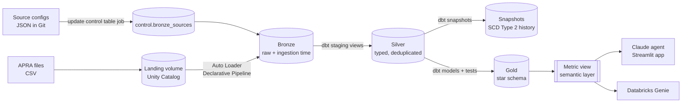

# Strategic Asset Allocation, Agentic AI

Ask a question about how Australia's largest super funds allocate their money, and an AI agent answers it from live, governed data: it writes the SQL, runs it on Databricks, checks the result, and picks the chart that best explains the answer.

Built on public APRA data (Quarterly Superannuation Performance Statistics, June 2026) with **Databricks**, **dbt**, **Unity Catalog**, **Claude** and **Streamlit**.

---

## What it does

> *"For the Growth risk profile, how has each fund's Australian vs international listed equity target changed over the last 5 financial years?"*

1. **Claude plans the query.** It reads a semantic layer (a Databricks metric view) that already knows the business rules, so it asks for `MEASURE(international_listed_equity_pct)` instead of re-inventing the maths.
2. **The app runs it on Databricks**, read-only, and hands back only the returned rows. Claude never invents a number.
3. **Claude checks and fixes itself.** If a query fails, it reads the error, rewrites the SQL and tries again.
4. **Claude picks the chart** (line for trends, bar for rankings, grouped or stacked bar for splits) and the app draws it. Viewers can switch chart type.
5. **Every answer is auditable.** The SQL and the raw rows behind each answer sit one click below it.

---

## Most innovative features

| Feature | Why it matters |
|---|---|
| **Agentic SQL with self-correction** | Claude writes, runs, debugs and re-runs its own queries through a tool loop, not a fixed set of canned reports. |
| **Agent-chosen visualisation** | A `show_chart` tool lets the model decide the chart type and columns for each answer, so the chart fits the question. |
| **Semantic layer shared by every consumer** | One dbt-built metric view defines the measures once; Claude, Databricks Genie and dashboards all use the same definitions, so numbers agree across tools. |
| **Risk profile by asset mix, not by name** | Funds label options inconsistently (an option called "Balanced" can hold 70% growth assets). Options are grouped into Conservative, Balanced, Growth and High growth by their actual share of growth assets, so comparisons are like for like. The agent is instructed to tell the two apart. |
| **Honest about missing data** | Where a fund doesn't split equity into Australian/international or developed/emerging, it stays an explicit "unspecified" group and is never silently merged. |
| **Metadata-driven ingestion** | Adding a data source = adding one JSON file in Git. No pipeline code changes, designed to scale to hundreds of sources. |
| **Full audit history** | dbt snapshots keep every version of every row (SCD Type 2), so any correction APRA publishes is traceable. |
| **Benchmarked against Genie** | The same benchmark questions are used to evaluate Databricks Genie and the Claude agent side by side (one click each in the app's sidebar). |

---

## Data architecture



### Layers

| Layer | Built with | What happens |
|---|---|---|
| **Landing** | Unity Catalog volume | Raw files land in one folder per source. |
| **Bronze** | Lakeflow Spark Declarative Pipelines + Auto Loader | One streaming table per source, created from the control table. Every row is kept; data-quality expectations **warn** instead of dropping, and an ingestion timestamp is added. |
| **Silver** | dbt (views) | Types cast, names cleaned, duplicates removed (latest load wins). |
| **Snapshots** | dbt snapshots | SCD Type 2 history of every dimension and fact row; rows that disappear are closed, not deleted. |
| **Gold** | dbt (tables) | Star schema: `fact_investment_strategic_allocation` plus `dim_fund`, `dim_investment_option`, `dim_asset_class`, `dim_date`. |
| **Semantic layer** | dbt `metric_view` materialisation | `metric_strategic_allocation`: dimensions (fund, risk profile, sector, domicile...) and measures (equity %, international share, 1-year and 5-year change...) defined once. |

### Design decisions

- **Databricks ingests, dbt transforms.** Bronze is the only layer built in Databricks; silver, gold, tests, documentation and lineage live in dbt, which keeps the business logic portable.
- **Facts are never filtered.** The fact table keeps all 362 investment options; the 39 compared options are selected by an inner join to `dim_investment_option`, so the selection rule can change without reloading data.
- **Comparable options only.** Per fund and risk profile, the largest *diversified* option (holds both shares and cash/bonds) is compared, by total member assets.
- **Dates come from the data.** "Latest", "last 5 financial years" and "1 year ago" are always derived with SQL, never hard-coded.
- **Descriptions flow to the catalog.** dbt `persist_docs` copies every table and column description into Unity Catalog, which is what Genie and the agent read.

### Data quality and governance

- **dbt data tests:** keys unique and not null, relationships between facts and dimensions, accepted values for risk profiles, and a custom test that each option's allocation adds up to 100%.
- **dbt unit tests:** prove the silver deduplication logic keeps the latest load.
- **Snapshot tests:** one current version per key, no duplicate versions.
- **Unity Catalog:** catalog, schemas and volume created from code (`setup/`), with descriptions on every gold table and column.
- **CI on every pull request (GitHub Actions):** validates the ingestion config files and parses the whole dbt project.

### Orchestration

One Databricks job runs the full refresh in order:

1. `update_control_table`: loads the source config files from Git into the control table.
2. `load_bronze_tables`: runs the bronze pipeline.
3. `build_silver_and_gold`: runs dbt from the Git repository.

---

## The agent app

- **Model:** Claude (Sonnet by default, configurable), called through the Anthropic SDK tool runner.
- **Tools:** `run_sql` (single `SELECT`/`WITH` statements only, max 500 rows) and `show_chart`.
- **Guardrails:** the agent may only use numbers its queries return, must compare funds within one risk profile, and must ask when "Balanced" could mean a risk profile or an option name.
- **Access:** browser sign-in to Databricks (OAuth) on a laptop, or a token when hosted. API spend is protected by an optional password and a per-session question limit.

Run it locally: see [`app/README.md`](app/README.md).

---

## Repository layout

```
setup/        Unity Catalog objects (catalog schemas, landing volume)
ingestion/    Source config files, control table job, bronze pipeline
dbt/          Silver and gold models, snapshots, tests, metric view
app/          Claude + Streamlit agent app
.github/      CI checks on every pull request
```

---

## About the data

APRA publishes each investment option's **strategic asset allocation**: the board-approved target mix across cash, bonds, shares, property and alternatives. The project covers 10 large funds, quarterly from June 2014 to June 2026.

Growth assets = shares + half of property, infrastructure and alternatives (a project assumption). Risk profiles follow common industry bands: Conservative up to 40%, Balanced 41 to 60%, Growth 61 to 80%, High growth 81 to 95%.
